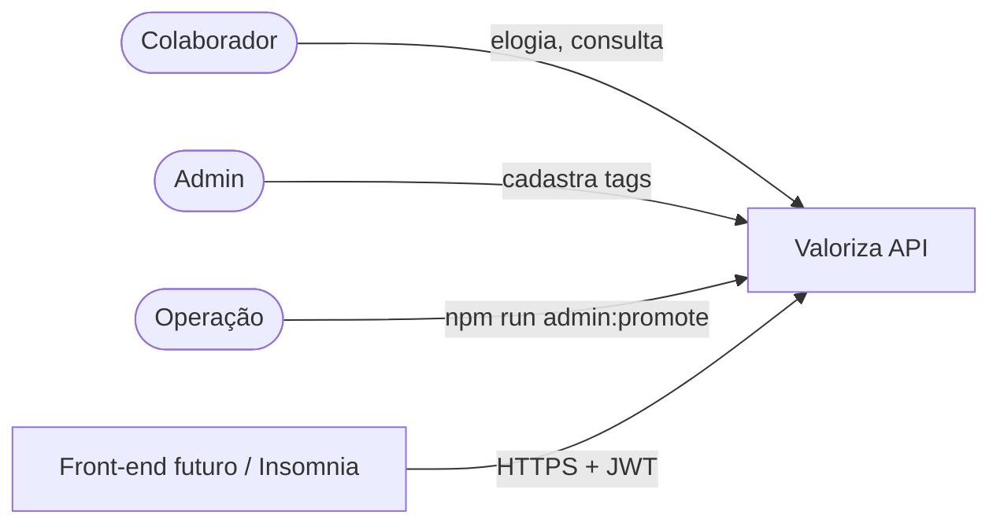
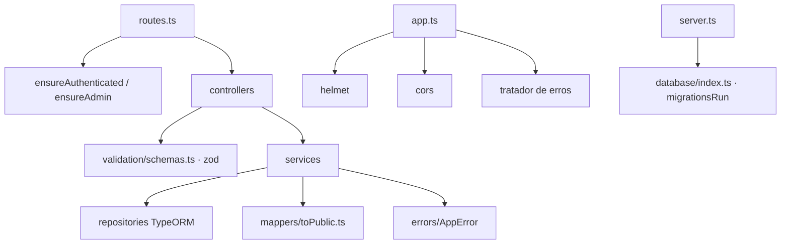
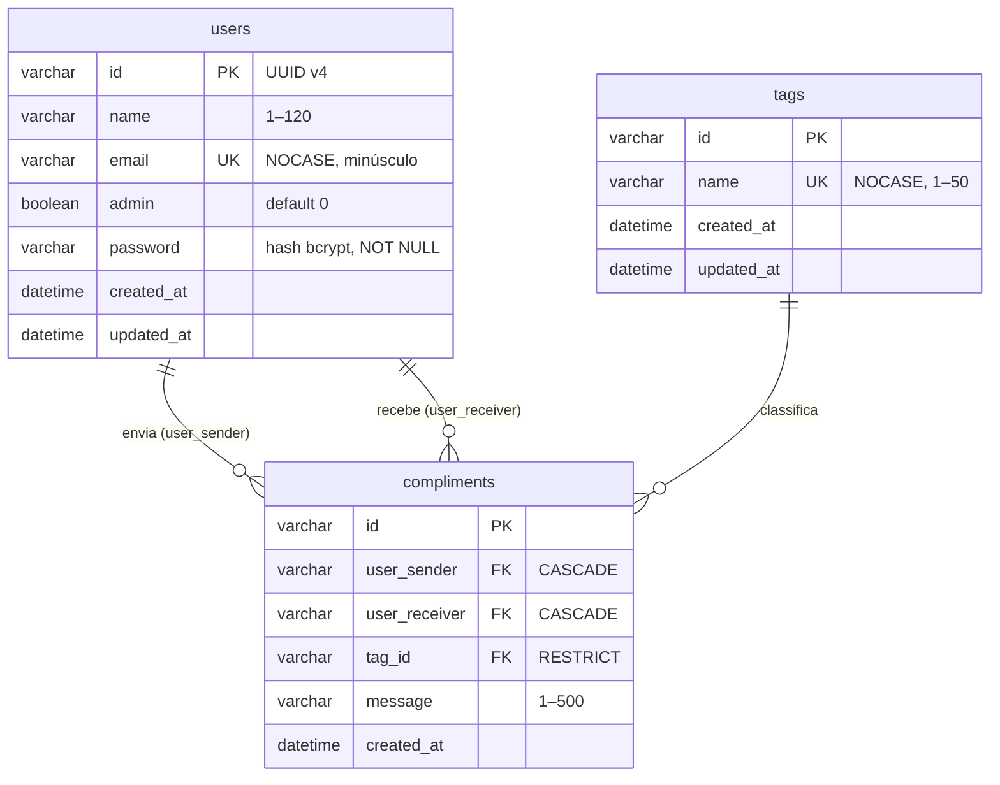

# Arquitetura alvo — Valoriza

## 1. Visão C4

### Nível 1 — Contexto



### Nível 2 — Contêineres

| Contêiner | Tecnologia | Responsabilidade |
|---|---|---|
| API REST | Node.js 20+, Express 4, TypeScript 5 | Autenticação JWT, regras de negócio, JSON |
| Banco | SQLite via TypeORM 0.2 (`sqlite3`) | Usuários, tags e elogios |
| Hospedagem gratuita | Render (web service free) ou alwaysdata | `npm run build` + `npm start`; `JWT_SECRET` como variável secreta |

### Nível 3 — Componentes



- **Controller:** valida a entrada com zod e chama o serviço.
- **Serviço:** aplica RN01–RN06 e lança `AppError` com o status certo.
- **Mapper:** define o contrato de saída campo a campo (lista de permissão), então um campo novo na entidade nunca vaza por acidente.

## 2. Estrutura de pastas

```
src/
├── app.ts                 (novo) Express + helmet + CORS + erros
├── server.ts              (reescrito) conecta ao banco e sobe
├── config.ts              (novo) variáveis de ambiente; JWT_SECRET obrigatório
├── routes.ts
├── controllers/           (validação com zod, status 201)
├── services/              (regras + AppError)
├── repositories/
├── entities/              (password com select: false)
├── mappers/toPublic.ts    (novo) DTOs de saída
├── validation/schemas.ts  (novo)
├── errors/AppError.ts     (novo)
├── middlewares/
├── scripts/promoteAdmin.ts (novo)
└── database/
    ├── index.ts           (reescrito) conexão programática + migrations na subida
    └── migrations/        (+ 1727420000000-HardenSchema.ts)
tests/api.test.ts          (novo) node:test + supertest, SQLite em memória
```

## 3. Modelo de dados (3FN)



- **3FN:** cada atributo depende só da chave; o nome formatado `#tag` é derivado na saída, não armazenado.
- **Integridade:** `UNIQUE COLLATE NOCASE` em e-mail e tag (fecha a corrida *check-then-act*); `CHECK (user_sender <> user_receiver)` reforça RN04 no banco; excluir usuário apaga seus elogios (`CASCADE`); tag em uso não pode ser apagada (`RESTRICT`).
- **Índices:** `(user_receiver, created_at)` e `(user_sender, created_at)` atendem às duas listagens ordenadas sem varredura; `(tag_id)` atende à checagem do `RESTRICT`.
- **Migração HardenSchema:** o SQLite não altera restrições, então a migration cria tabelas novas, copia os dados válidos (e-mails em minúsculas, elogios órfãos descartados), troca as tabelas e cria os índices, dentro da transação do TypeORM. Testada no banco atual: 9 usuários, 4 tags e 4 elogios preservados.

## 4. Contrato da API

Erros sempre no formato `{ "error": "mensagem em português" }`.

| Método | Rota | Auth | Corpo | Sucesso | Erros |
|---|---|---|---|---|---|
| GET | `/health` | — | — | 200 `{status:"ok"}` | — |
| POST | `/users` | — | `name`, `email`, `password` (8–72) | 201 `{id,name,email,admin:false}` | 400, 409 |
| POST | `/login` | — | `email`, `password` | 200 `{token, user}` | 400, 401 |
| GET | `/users` | JWT | — | 200 `[{id,name}]` | 401 |
| POST | `/tags` | JWT + admin | `name` (1–50) | 201 `{id,name,name_custom}` | 400, 401, 403, 409 |
| GET | `/tags` | JWT | — | 200 `[{id,name,name_custom}]` | 401 |
| POST | `/compliments` | JWT | `tag_id`, `user_receiver` (UUID), `message` (1–500) | 201 elogio | 400, 401, 404, 422 |
| GET | `/users/compliments/send` | JWT | — | 200 `[{id,message,created_at,tag,sender,receiver}]` | 401 |
| GET | `/users/compliments/receive` | JWT | — | 200 idem | 401 |

## 5. Decisões de arquitetura (ADR)

### ADR-001 — Segredo do JWT só por ambiente, com falha na subida

- **Decisão:** `JWT_SECRET` obrigatório com ≥ 32 caracteres; algoritmo fixado em HS256 na verificação.
- **Consequência:** tokens assinados com o segredo antigo (que está no histórico do Git) deixam de valer. Todos os usuários precisam fazer login de novo.

### ADR-002 — Admin só por operação

- **Decisão:** `POST /users` sempre cria `admin = false`; a promoção é feita por `npm run admin:promote -- email`.
- **Consequência:** elimina o escalonamento de privilégio sem criar uma rota de administração nova.

### ADR-003 — DTOs explícitos em vez de `class-transformer`

- **Contexto:** `@Exclude` só funciona se toda resposta passar por `classToPlain`; a listagem de elogios não passava e vazava hashes.
- **Decisão:** mappers com lista de permissão + `select: false` na coluna `password` (defesa em profundidade). Dependência `class-transformer` removida.

### ADR-004 — Manter TypeORM 0.2

- **Contexto:** a 0.3 remove `getCustomRepository` e `createConnection`, o que exigiria reescrever todos os serviços.
- **Decisão:** manter 0.2.45 (última da série) neste ciclo; migrar para 0.3 com `DataSource` é o próximo passo técnico.

### ADR-005 — Build com `tsc` para produção

- **Decisão:** `npm run build` gera `dist/`; `npm start` roda JavaScript puro. `ts-node-dev` fica só no desenvolvimento.

## 6. Fora do escopo deste ciclo

- Front-end (item do README), notificação por e-mail, paginação das listagens.
- Troca de senha, recuperação de senha e *refresh token*.
- TypeORM 0.3 e PostgreSQL.
